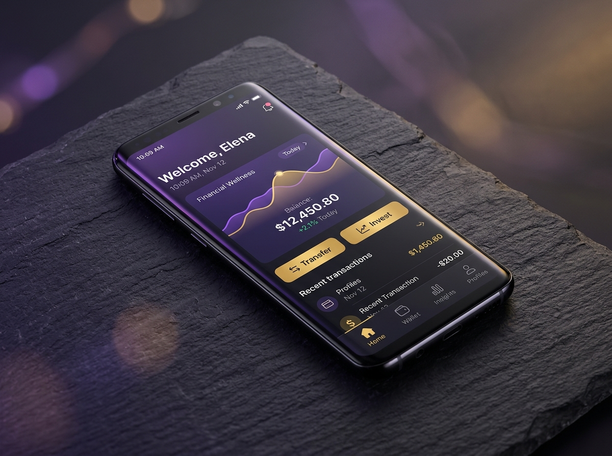

<div align="center">

# 🏛️ Enes Öztürk Ajans
### Portföy & Web Yönetim Platformu

**Tasarım & Geliştirme:** Enes Öztürk

[](https://react.dev)
[](https://www.typescriptlang.org)
[](https://vite.dev)
[](https://tailwindcss.com)
[](https://developer.mozilla.org/docs/Web/API/Window/localStorage)
[](https://heroku.com)

> **PCAT** ve **SmartEdu** projelerinden gelen CRUD ve iletişim mimarisini tek bir profesyonel ajans ekosisteminde birleştiren modern web uygulaması.

</div>


---

## ✨ Öne Çıkanlar

| | Özellik | Açıklama |
|:-:|---|---|
| 🗂️ | **Dinamik portföy CRUD** | Proje ekleme, düzenleme ve silme; görsel, müşteri, tarih, kategori ve teknoloji etiketleri |
| 🔎 | **Kategori + arama** | Web Tasarım · Grafik Tasarım · Yazılım & API filtreleri ve proje/müşteri adına göre arama |
| ⭐ | **Öne çıkan projeler** | `featured` işaretli çalışmalar vitrinde öne çıkar |
| 🪟 | **Detay modalı** | Müşteri, tarih, açıklama, teknolojiler ve canlı proje bağlantısı |
| ✉️ | **İletişim formu** | Ad, e-posta, konu ve mesaj doğrulaması; gönderimde toast bildirimi |
| 📥 | **Mesaj gelen kutusu** | Formdan gelen mesajları görüntüleme ve silme |
| 🧭 | **Kurumsal bölümler** | Hero + KPI şeridi, hizmetler, hakkında (4 adımlı yol haritası), ekip ve footer |
| ☁️ | **Dağıtım rehberi** | GitHub ve Heroku adımları, kopyalanabilir komutlar |
| 💾 | **JSON yedekleme** | Portföyü `.json` olarak indirme ve geri yükleme |
| 🔁 | **Kalıcı veri** | Tüm değişiklikler `localStorage` üzerinde saklanır; varsayılanlara dönüş |
| 📱 | **Duyarlı tasarım** | Mobil menü, koyu tema ve amber vurgulu kurumsal arayüz |

## 🖼️ Portföyden

| Web Tasarım | Kurumsal Kimlik |
|:-:|:-:|
|  |  |
| **Aurora Studio** · Yüksek performanslı kurumsal platform | **Aethel Luxury** · Minimalist marka ve ambalaj tasarımı |

| Mobil Uygulama |
|:-:|
|  |
| **Galata Finans** · Fintech mobil arayüzü |

## 🧩 Uygulama bölümleri

| Bölüm | İçerik |
|---|---|
| **Hero** | Ajans konumlandırması, CRUD çağrıları ve 4 metrikli KPI şeridi |
| **Hizmetler** | Web & full-stack, marka kimliği, mobil UI/UX ve dinamik CMS kartları |
| **Portföy** | Kategori filtreleri, arama, proje kartları, düzenleme ve silme |
| **Hakkında** | PCAT → SmartEdu → Ajans → Bulut dağıtım yol haritası |
| **Ekip** | Kreatif direktör, backend/DevOps ve UX stratejisti profilleri |
| **İletişim** | Doğrulamalı form ve mesaj gelen kutusu |
| **Footer** | Hızlı bağlantılar, iletişim ve imza |

## 🛠️ Teknolojiler

| Katman | Teknoloji |
|---|---|
| UI | React 19, TypeScript |
| Build | Vite |
| Stil | Tailwind CSS 4 |
| İkonlar | lucide-react |
| Veri | Tarayıcı `localStorage` (sunucusuz) |
| Dağıtım | Heroku (`Procfile` → `web: npm start`), GitHub |

## 🗂️ Proje yapısı

```
projeler/ajans-portfolyo/
├── public/
│   └── assets/images/          # Hero ve portföy görselleri
├── src/
│   ├── components/
│   │   ├── Navbar.tsx
│   │   ├── Hero.tsx
│   │   ├── ServicesSection.tsx
│   │   ├── PortfolioSection.tsx
│   │   ├── PortfolioDetailModal.tsx
│   │   ├── AddEditProjectModal.tsx
│   │   ├── DeleteConfirmModal.tsx
│   │   ├── MessagesModal.tsx
│   │   ├── DeployGuideModal.tsx
│   │   ├── AboutSection.tsx
│   │   ├── TeamSection.tsx
│   │   ├── ContactSection.tsx
│   │   └── Footer.tsx
│   ├── data/initialData.ts     # Örnek projeler ve mesajlar
│   ├── utils/storage.ts        # localStorage okuma / yazma / sıfırlama
│   ├── types/index.ts
│   ├── App.tsx
│   ├── main.tsx
│   └── index.css
├── index.html
├── Procfile
├── package.json
└── vite.config.ts
```

## 🚀 Çalıştırma

```bash
npm install
npm run dev
```

Ardından `http://localhost:3000` adresini aç.

```bash
npm run build     # üretim derlemesi
npm run preview   # derlemeyi önizle
```

## 💾 Veri & kalıcılık

| Anahtar | İçerik |
|---|---|
| `enes_ozturk_agency_portfolio_v1` | Portföy projeleri |
| `enes_ozturk_agency_messages_v1` | İletişim mesajları |

- İlk açılışta örnek projeler ve mesajlar yüklenir.
- **“Varsayılan örnek projeleri geri yükle”** ile veriler sıfırlanabilir.
- Dağıtım rehberindeki **JSON İndir / JSON Yükle** araçlarıyla portföy yedeklenebilir.

## 📌 Notlar

- Uygulama tamamen istemci tarafında çalışır; veritabanı veya API anahtarı gerektirmez.
- İletişim formu mesajları tarayıcıda saklar (demo amaçlı).
- Portföy görselleri `public/assets/images` altında tutulur; geliştirme ve üretim derlemesinde doğrudan sunulur.

---

<div align="center">

### 👤 Enes Öztürk

**Full Stack Developer · UI/UX · Marka Tasarımı**

[](https://github.com/EnesBinMalik)

<sub>Tasarlandı ve geliştirildi — **Enes Öztürk**</sub>

</div>
