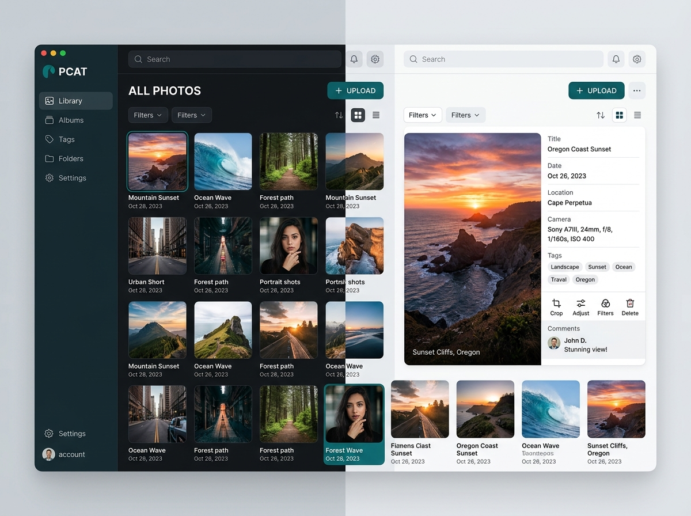
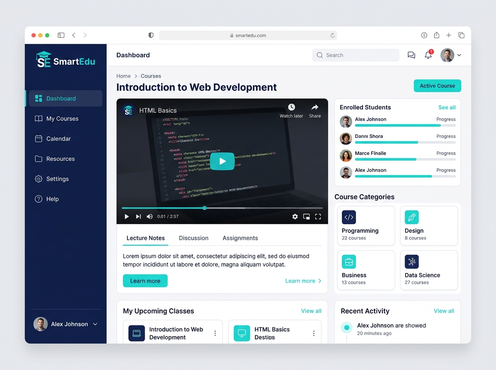

<div align="center">

# ✦ ENES ÖZTÜRK
### Freelancer Portföy

**Graphic Artist · Web Designer · Full Stack Developer**

[](https://react.dev)
[](https://www.typescriptlang.org)
[](https://vite.dev)
[](https://tailwindcss.com)
[](https://developer.mozilla.org/docs/Web/API/Window/localStorage)
[](https://heroku.com)

> Klasik freelancer vitrinini dinamik bir portföy yönetim paneline dönüştüren; proje ekleme, düzenleme, silme ve gelen teklifleri yönetme imkânı sunan kişisel web uygulaması.

</div>


---

## ✨ Öne Çıkanlar

| | Özellik | Açıklama |
|:-:|---|---|
| 🖼️ | **Dinamik proje vitrini** | Görsel, kategori, müşteri, tarih ve teknoloji etiketleriyle proje kartları |
| 🔎 | **Kategori filtreleri** | Tümü · Node.js & Express · Full Stack · Web Geliştirme · Mobil & UI |
| 🪟 | **Proje detay modalı** | Uzun açıklama, teknolojiler, GitHub deposu ve canlı demo bağlantısı |
| 🛠️ | **Proje CRUD** | Yeni proje ekleme, düzenleme ve onaylı silme |
| ⭐ | **Öne çıkan projeler** | `featured` projeler vitrinde ayrı vurgulanır |
| 👤 | **Hakkında bölümü** | Tanıtım, yetkinlik şeridi ve klasik iki sütunlu freelancer düzeni |
| 📄 | **CV modülü** | Tarayıcıda oluşturulan metin tabanlı özgeçmişi görüntüleme ve `.txt` olarak indirme |
| ✉️ | **İletişim formu** | Ad, e-posta, konu ve mesaj doğrulaması; başarı bildirimi |
| 📥 | **Gelen kutusu** | Formdan gelen teklif ve mesajları görüntüleme, silme |
| ☁️ | **Dağıtım rehberi** | GitHub ve Heroku için adım adım komutlar |
| 🔁 | **Kalıcı veri** | Projeler ve mesajlar `localStorage` üzerinde saklanır |
| 📱 | **Duyarlı tasarım** | Turkuaz (`#1abc9c`) ve lacivert (`#2c3e50`) temalı, mobil uyumlu arayüz |

## 🖼️ Projelerden

| PCAT Fotoğraf Kataloğu | SmartEdu Eğitim Platformu |
|:-:|:-:|
|  |  |
| **Node.js & Express** · CRUD, Multer, MongoDB | **Full Stack** · RBAC, Nodemailer, LMS |

| Aura E-Ticaret Paneli | Freelance Suite |
|:-:|:-:|
|  |  |
| **Web Geliştirme** · Sipariş, stok ve satış grafikleri | **Mobil & UI** · Modüler freelance çözümleri |

## 🧩 Uygulama bölümleri

| Bölüm | İçerik |
|---|---|
| **Hero** | Avatar, isim, unvan, proje rozetleri ve hızlı eylemler |
| **Portföy** | Kategori filtreleri, proje grid'i, düzenleme/silme ve detay modalı |
| **Hakkında** | Kişisel tanıtım, yetkinlik şeridi ve CV görüntüleme/indirme |
| **İletişim** | Doğrulamalı form ve gelen kutusu |
| **Footer** | Sosyal bağlantılar ve imza |

## 🛠️ Teknolojiler

| Katman | Teknoloji |
|---|---|
| UI | React 19, TypeScript |
| Build | Vite |
| Stil | Tailwind CSS 4 |
| İkonlar | lucide-react |
| Veri | Tarayıcı `localStorage` (sunucusuz) |
| Dağıtım | GitHub, Heroku |

## 🗂️ Proje yapısı

```
projeler/freelancer-portfolyo/
├── public/
│   └── assets/images/          # Avatar ve proje görselleri
├── src/
│   ├── components/
│   │   ├── Navbar.tsx
│   │   ├── Hero.tsx
│   │   ├── StarDivider.tsx
│   │   ├── PortfolioGrid.tsx
│   │   ├── ProjectModal.tsx
│   │   ├── AddEditProjectModal.tsx
│   │   ├── DeleteConfirmModal.tsx
│   │   ├── AboutSection.tsx
│   │   ├── ContactSection.tsx
│   │   ├── MessagesInboxModal.tsx
│   │   ├── DeployGuideModal.tsx
│   │   └── Footer.tsx
│   ├── data/initialProjects.ts # Örnek projeler ve mesajlar
│   ├── types/index.ts
│   ├── App.tsx
│   ├── main.tsx
│   └── index.css
├── index.html
├── package.json
└── vite.config.ts
```

## 🚀 Çalıştırma

```bash
npm install
npm run dev
```

Ardından `http://localhost:3000` adresini aç.

```bash
npm run build     # üretim derlemesi
npm run preview   # derlemeyi önizle
```

## 💾 Veri & kalıcılık

| Anahtar | İçerik |
|---|---|
| `freelancer_projects_enes_ozturk` | Portföy projeleri |
| `freelancer_messages_enes_ozturk` | İletişim mesajları |

- İlk açılışta örnek projeler ve mesajlar yüklenir.
- Tüm ekleme, düzenleme ve silme işlemleri otomatik olarak `localStorage`'a yazılır.

## 📌 Notlar

- Uygulama tamamen istemci tarafında çalışır; veritabanı veya API anahtarı gerektirmez.
- CV dosyası tarayıcıda `Blob` ile üretilir; harici bir dosya sunucusu kullanılmaz.
- Proje görselleri `public/assets/images` altında tutulur; geliştirme ve üretim derlemesinde doğrudan sunulur.

---

<div align="center">

### 👤 Enes Öztürk

**Graphic Artist · Web Designer · Full Stack Developer**

[](https://github.com/EnesBinMalik)

<sub>Tasarlandı ve geliştirildi — **Enes Öztürk**</sub>

</div>
