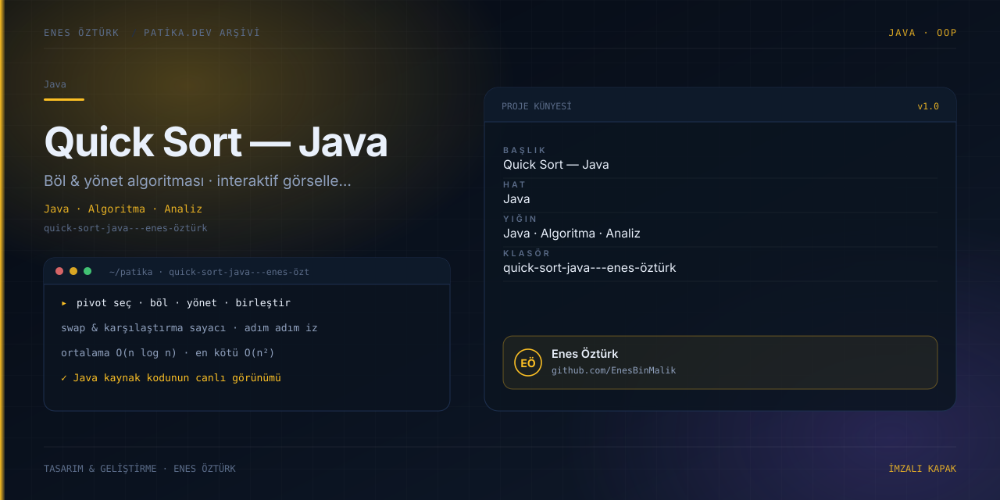

# Quick Sort Java - Enes Öztürk



> **Patika.dev arşivi · Java · algoritma analizi** — tasarım ve geliştirme: **Enes Öztürk**

---

Quick Sort (hızlı sıralama) algoritmasının Java uygulaması; diziyi adım adım sıralayan görselleştirici, karşılaştırma/takas sayaçları ve karmaşıklık analiziyle birlikte.

## Öne çıkanlar

- **Adım adım görselleştirme** — pivot seçimi, bölümleme ve birleştirme.
- **Sayaçlar** — karşılaştırma ve takas sayısı, geçen adım.
- **Karmaşıklık analizi** — ortalama `O(n log n)`, en kötü `O(n²)`.
- **Kod görüntüleyici** — Java kaynak kodunun vurgulanmış hâli.
- Girdi havuzu ve rastgele dizi üretimi.

## Teknoloji

React · TypeScript · Vite. Her klasör kendi `package.json`'ına sahip bağımsız bir projedir; kök dizinde kurulum yapılmaz.

## Kurulum ve çalıştırma

```bash
cd "quick-sort-java---enes-öztürk"
npm install
npm run dev
```

| Komut | Not |
| --- | --- |
| `npm install` | bağımlılıklar |
| `npm run dev` | http://localhost:3000 |
| `npm run build` | üretim derlemesi |
| `npm run lint` | tsc --noEmit |

## Proje yapısı

```
quick-sort-java---enes-öztürk/
├── index.html
├── package.json
├── docs/cover.svg            # imza kapak
└── src/
    ├── App.tsx               # ekranların birleştiği yer
    ├── main.tsx
    ├── components/
    ├── data/
    └── utils/
```

## Lisans

Ödev ve portföy amaçlı çalışma; tüm hakları **Enes Öztürk**'e aittir.

## Katkı

Bu proje **Enes Öztürk** tarafından geliştirildi. Hata bildirimi ve öneri için GitHub üzerinden issue açabilirsiniz.

---

_Eş yazarlı commit ile hazırlandı._
