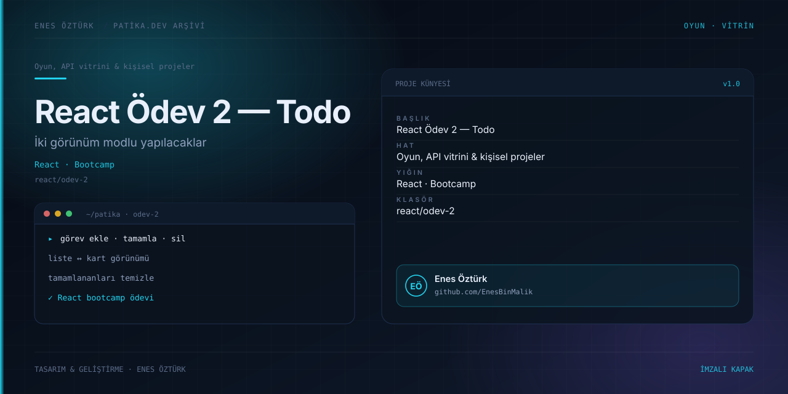

# odev-2



> **Patika.dev arşivi · React · durum yönetimi** — tasarım ve geliştirme: **Enes Öztürk**

---

Görev ekleme, tamamlama ve silme akışını iki farklı görünüm modunda sunan Todo uygulaması.

## Öne çıkanlar

- Görev ekleme, tamamlama ve silme.
- Liste ve kart görünümü.
- Tamamlananları toplu temizleme.
- Kalan görev sayacı.

## Teknoloji

React · TypeScript · Vite. Her klasör kendi `package.json`'ına sahip bağımsız bir projedir; kök dizinde kurulum yapılmaz.

## Kurulum ve çalıştırma

```bash
cd "react/odev-2"
npm install
npm run dev
```

| Komut | Not |
| --- | --- |
| `npm install` | bağımlılıklar |
| `npm run dev` | http://localhost:3000 |
| `npm run build` | üretim derlemesi |

## Proje yapısı

```
odev-2/
├── index.html
├── package.json
├── docs/cover.svg            # imza kapak
└── src/
    ├── App.tsx               # ekranların birleştiği yer
    ├── main.tsx
    ├── components/
    ├── hooks/
    ├── types/
    └── utils/
```

## Lisans

Ödev ve portföy amaçlı çalışma; tüm hakları **Enes Öztürk**'e aittir.
