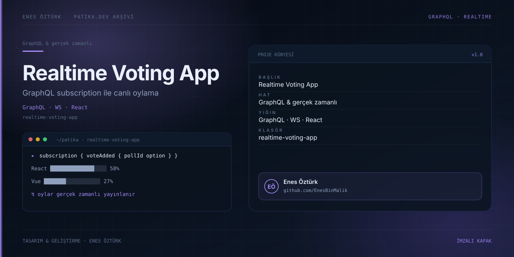

# Realtime Voting App



> **Patika.dev arşivi · GraphQL · gerçek zamanlı** — tasarım ve geliştirme: **Enes Öztürk**

---

GraphQL subscription'larıyla oyların anlık yayınlandığı oylama ve anket uygulaması.

## Öne çıkanlar

- Anket oluşturma ve oy verme.
- Sonuçların gerçek zamanlı güncellenmesi.
- Yüzde çubukları ve toplam oy.
- Sunucu tarafında GraphQL şeması.

## Teknoloji

React · TypeScript · Vite. Her klasör kendi `package.json`'ına sahip bağımsız bir projedir; kök dizinde kurulum yapılmaz.

## Kurulum ve çalıştırma

```bash
cd "realtime-voting-app"
npm install
npm run dev
```

| Komut | Not |
| --- | --- |
| `npm install` | bağımlılıklar |
| `npm run dev` | http://localhost:3000 |
| `npm run build` | üretim derlemesi |

## Proje yapısı

```
realtime-voting-app/
├── index.html
├── package.json
├── docs/cover.svg            # imza kapak
└── src/
    ├── App.tsx               # ekranların birleştiği yer
    ├── main.tsx
    ├── components/
    ├── lib/
    └── server/
```

## Lisans

Ödev ve portföy amaçlı çalışma; tüm hakları **Enes Öztürk**'e aittir.
