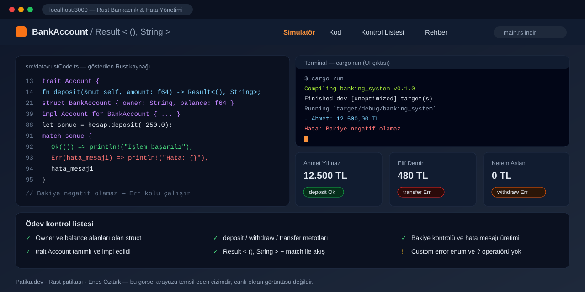

# Rust Bankacılık Sistemi & Hata Yönetimi — İnteraktif İnceleme Uygulaması



> **Patika.dev · Rust patikası — "Bankacılık Sistemi & Hata Yönetimi" ödevi**
> Enes Öztürk

## Önemli: bu klasör neyi içeriyor?

Bu klasördeki proje **derlenebilir bir Rust crate'i değil**, Rust çözümünü tarayıcıda gösteren ve
canlandıran bir **React + TypeScript (Vite)** uygulamasıdır. Depoda `Cargo.toml` veya `.rs` dosyası
yoktur; Rust kaynak kodu `src/data/rustCode.ts` içinde şablon dize olarak tutulur ve arayüzde
renklendirilmiş olarak gösterilir. Uygulama "Derleme başarılı" gibi çıktılar üretir, bunlar
**arayüz animasyonudur** — arka planda `rustc` çalıştırılmaz.

Rust kodunun gerçek hâlini çalıştırmak için arayüzdeki **main.rs indir** düğmesini kullan, ardından:

```bash
cargo new banking_system
# indirilen main.rs dosyasını banking_system/src/main.rs ile değiştir
cd banking_system && cargo run
```

## Ne yapıyor?

`trait Account` + `struct BankAccount` ile kurulan hesap modelini, `Result<(), String>` ve `match`
kullanılarak yazılan negatif bakiye / yetersiz bakiye / sıfıra transfer hatalarını adım adım gösteren
dört sekmeli bir inceleme aracı:

| Sekme | İçerik |
| --- | --- |
| **Simulatör** | Hesap durumunu değiştiren butonlar ve `Ok` / `Err` çıktısının canlandırılması |
| **Kod** | Rust kaynağının satır numaralı, renklendirilmiş görüntüsü + `main.rs` indirme |
| **Kontrol Listesi** | Ödev gereksinimlerinin karşılanma durumu |
| **Rehber** | Sahiplik, `Result` ve `match` üzerine konu anlatımı |

## Teknoloji

| Katman | Kullanılan |
| --- | --- |
| UI | React 19, TypeScript |
| Build | Vite 8, `@tailwindcss/vite` (Tailwind v4) |
| İkonlar | `lucide-react` |
| Durum | Bileşen içi `useState` (Redux yok) |

## Kurulum ve çalıştırma

```bash
npm install
npm run dev        # http://localhost:3000
```

| Komut | Açıklama |
| --- | --- |
| `npm run dev` | Vite geliştirme sunucusu (`--port=3000 --host=0.0.0.0`) |
| `npm run build` | Üretim derlemesi (`dist/`) |
| `npm run preview` | Derlenmiş çıktıyı yerelde sunar |
| `npm run lint` | `tsc --noEmit` — yalnızca tip kontrolü, ESLint çalıştırmaz |
| `npm run clean` | **Windows'ta çalışmaz** (`rm -rf` POSIX komutu) |

## Proje yapısı

```
rust-bankacılık-sistemi-&-hata-yönetimi/
├── index.html                 # Vite girişi
├── src/
│   ├── main.tsx               # createRoot → <App/>
│   ├── App.tsx                # Sekme yönetimi, simülasyon state'i
│   ├── data/rustCode.ts       # Gösterilen Rust kaynağı (satır 13 trait, 21 struct, 39 impl, 74 main)
│   ├── utils/rustBankingSimulator.ts  # Rust mantığının TypeScript karşılığı
│   ├── types/banking.ts       # ResultType<T, E>, BankAccountState
│   └── components/            # Navbar, CodeViewer, Terminal, InteractiveTestbench, Checklist, SignatureCard, TheoryGuide
└── docs/cover.svg             # Bu README'deki kapak çizimi
```

## Model ve hata yönetimi yaklaşımı

- `trait Account` (`rustCode.ts:13`) — `deposit`, `withdraw`, `transfer` imzaları `Result<(), String>` döner.
- `struct BankAccount` (`:21`) — `owner: String`, `balance: f64`; `impl Account for BankAccount` (`:39`).
- Hata yolları `match sonuc { Ok(()) => ..., Err(hata_mesaji) => ... }` ile ele alınır (`:91`, `:109`).
- TypeScript tarafında aynı mantık `SimulatedRustAccount` (`utils/rustBankingSimulator.ts:3`) ve
  `ResultType<T, E>` (`types/banking.ts:7`) ile taklit edilir.

## Bilinen kısıtlar ve yapılacaklar

- [ ] `?` operatörü ve özel bir `enum BankingError` (thiserror) kullanılmadı; hatalar `String`.
- [ ] Rust tarafında test yok — `mod tests` eklenip `cargo test` ile doğrulanmalı.
- [ ] `TASK_STEPS` satır bağlantıları 5–8. adımlarda gerçek satırlardan ~5 satır kaymış.
- [ ] Arayüz metinleri "hatasız derlendi" / "testler geçti" diyor; bunlar gerçek değil — etiketler
      "temsilî çıktı" olarak düzeltilmeli.
- [ ] `@google/genai`, `express`, `dotenv`, `motion` bağımlılıkları hiçbir yerde kullanılmıyor;
      `package.json`'dan silinmeli. `typescript: ^7.0.2` gibi var olmayan sürüm aralıkları sabitlenmeli.
- [ ] `App.tsx:141` içindeki `setTimeout` unmount'ta temizlenmiyor.
- [ ] `TransactionRecord` tipi (`types/banking.ts:11`) hiç kullanılmıyor.

## Lisans

Ödev amaçlı çalışma; kaynak kodu eğitimi gören Enes Öztürk'e aittir.
