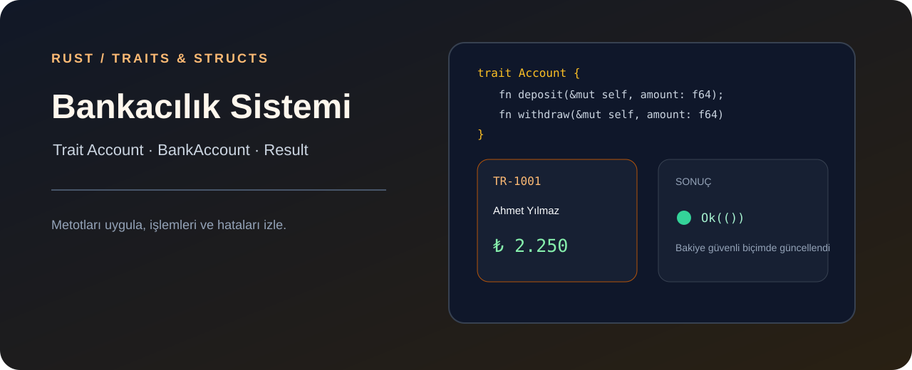

# Rust Bankacılık Sistemi (Traits & Structs) - Enes Öztürk



> **Patika.dev arşivi · Rust · trait & struct** — tasarım ve geliştirme: **Enes Öztürk**

---

`trait` ve `struct` ile banka hesabı modelleyen; para yatırma, çekme ve bakiye sorgulama ödevi.

## Öne çıkanlar

- `Hesap` trait'i ve `BankAccount` struct'ı.
- Yatırma, çekme ve bakiye sorgulama.
- Bakiye yetersizliği kontrolü.
- Rust kaynak kodunun gösterimi.

## Teknoloji

React · TypeScript · Vite. Her klasör kendi `package.json`'ına sahip bağımsız bir projedir; kök dizinde kurulum yapılmaz.

## Kurulum ve çalıştırma

```bash
cd "rust-bankacılık-sistemi-(traits-&-structs)---enes-öztürk"
npm install
npm run dev
```

| Komut | Not |
| --- | --- |
| `npm install` | bağımlılıklar |
| `npm run dev` | http://localhost:3000 |
| `npm run build` | üretim derlemesi |

## Proje yapısı

```
rust-bankacılık-sistemi-(traits-&-structs)---enes-öztürk/
├── index.html
├── package.json
├── docs/cover.svg            # imza kapak
└── src/
    ├── App.tsx               # ekranların birleştiği yer
    ├── main.tsx
    ├── components/
    └── data/
```

## Lisans

Ödev ve portföy amaçlı çalışma; tüm hakları **Enes Öztürk**'e aittir.
