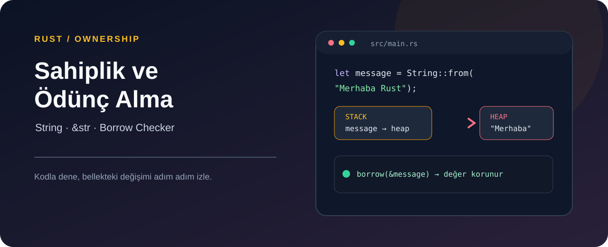

# Rust Sahiplik ve Referanslar Laboratuvarı



> **Patika.dev arşivi · Rust · ownership** — tasarım ve geliştirme: **Enes Öztürk**

---

Sahiplik (ownership), ödünç alma (borrowing) ve string dilimlerini interaktif olarak deneyen eğitim ortamı.

## Öne çıkanlar

- Sahiplik aktarımı ve ödünç alma senaryoları.
- String dilimi (`&s[0..n]`) örnekleri.
- Dize birleştirme ve bellek görselleştirmesi.
- Hata mesajlarının açıklaması.

## Teknoloji

React · TypeScript · Vite. Her klasör kendi `package.json`'ına sahip bağımsız bir projedir; kök dizinde kurulum yapılmaz.

## Kurulum ve çalıştırma

```bash
cd "rust-sahiplik-ve-referanslar-laboratuvarı"
npm install
npm run dev
```

| Komut | Not |
| --- | --- |
| `npm install` | bağımlılıklar |
| `npm run dev` | http://localhost:3000 |
| `npm run build` | üretim derlemesi |

## Proje yapısı

```
rust-sahiplik-ve-referanslar-laboratuvarı/
├── index.html
├── package.json
├── docs/cover.svg            # imza kapak
└── src/
    ├── App.tsx               # ekranların birleştiği yer
    ├── main.tsx
    ├── assets/
    ├── components/
    ├── types/
    └── utils/
```

## Lisans

Ödev ve portföy amaçlı çalışma; tüm hakları **Enes Öztürk**'e aittir.
