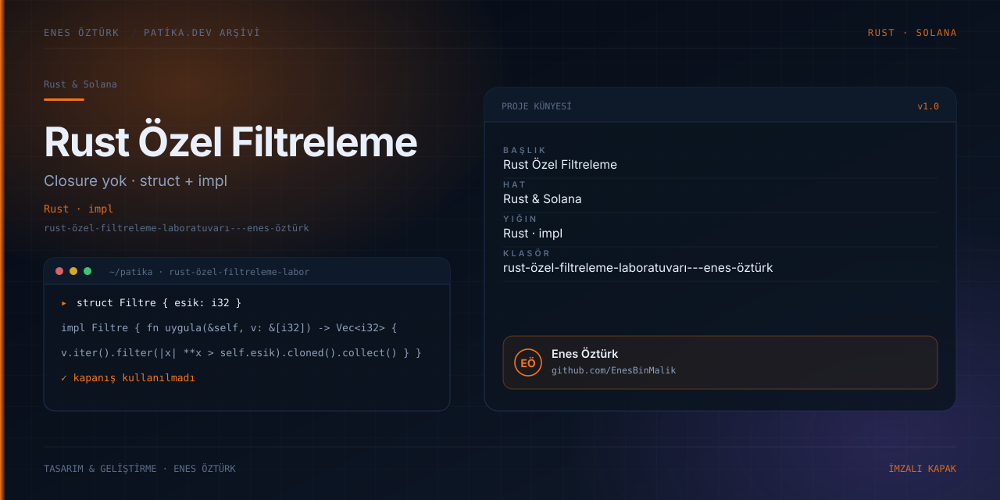

# Rust Özel Filtreleme Laboratuvarı - Enes Öztürk



> **Patika.dev arşivi · Rust · impl metotları** — tasarım ve geliştirme: **Enes Öztürk**

---

Kapanış (closure) kullanmadan, `struct` ve `impl` metotlarıyla yazılmış özel filtreleme fonksiyonu ve simülatörü.

## Öne çıkanlar

- Eşik değerine göre filtreleme.
- `impl` bloğunda tanımlı metotlar.
- Girdi/çıktı örnekleri.
- Kaynak kodun adım adım gösterimi.

## Teknoloji

React · TypeScript · Vite. Her klasör kendi `package.json`'ına sahip bağımsız bir projedir; kök dizinde kurulum yapılmaz.

## Kurulum ve çalıştırma

```bash
cd "rust-özel-filtreleme-laboratuvarı---enes-öztürk"
npm install
npm run dev
```

| Komut | Not |
| --- | --- |
| `npm install` | bağımlılıklar |
| `npm run dev` | http://localhost:3000 |
| `npm run build` | üretim derlemesi |

## Proje yapısı

```
rust-özel-filtreleme-laboratuvarı---enes-öztürk/
├── index.html
├── package.json
├── docs/cover.svg            # imza kapak
└── src/
    ├── App.tsx               # ekranların birleştiği yer
    ├── main.tsx
    ├── components/
    ├── data/
    ├── services/
    └── types/
```

## Lisans

Ödev ve portföy amaçlı çalışma; tüm hakları **Enes Öztürk**'e aittir.
