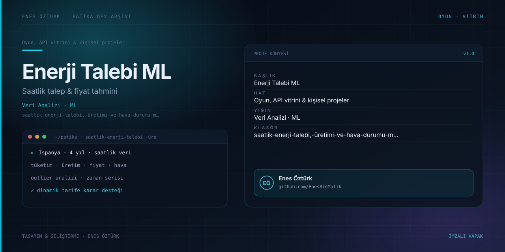

# Saatlik Enerji Talebi, Üretimi ve Hava Durumu ML Platformu



> **Patika.dev arşivi · Makine öğrenmesi · zaman serisi** — tasarım ve geliştirme: **Enes Öztürk**

---

İspanya'nın dört yıllık saatlik elektrik verisi ile beş büyük şehrin hava durumunu birleştirip talep ve fiyat tahmini yapan karar destek platformu.

## Öne çıkanlar

- Saatlik tüketim, üretim, fiyat ve hava durumu serileri.
- Aykırı değer (outlier) analizi ve temizleme adımları.
- Zaman serisi modelleme ve tahmin görünümü.
- Belediyeler için dinamik tarife simülatörü.

## Teknoloji

React · TypeScript · Vite. Her klasör kendi `package.json`'ına sahip bağımsız bir projedir; kök dizinde kurulum yapılmaz.

## Kurulum ve çalıştırma

```bash
cd "saatlik-enerji-talebi,-üretimi-ve-hava-durumu-ml-platformu"
npm install
npm run dev
```

| Komut | Not |
| --- | --- |
| `npm install` | bağımlılıklar |
| `npm run dev` | http://localhost:3000 |
| `npm run build` | üretim derlemesi |

## Proje yapısı

```
saatlik-enerji-talebi,-üretimi-ve-hava-durumu-ml-platformu/
├── index.html
├── package.json
├── docs/cover.svg            # imza kapak
└── src/
    ├── App.tsx               # ekranların birleştiği yer
    ├── main.tsx
    ├── components/
    ├── data/
    ├── types/
    └── utils/
```

## Lisans

Ödev ve portföy amaçlı çalışma; tüm hakları **Enes Öztürk**'e aittir.
