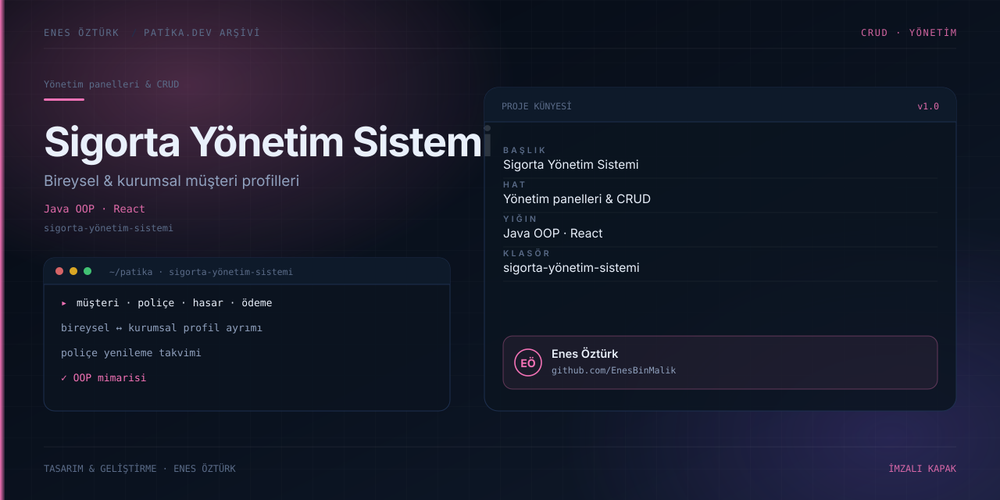

# Sigorta Yönetim Sistemi



> **Patika.dev arşivi · Java OOP · sigorta** — tasarım ve geliştirme: **Enes Öztürk**

---

Bireysel ve kurumsal müşteri profilleriyle çalışan, Java OOP mimarisine uygun sigorta yönetim sistemi.

## Öne çıkanlar

- Müşteri, poliçe ve hasar kayıtları.
- Bireysel / kurumsal profil ayrımı.
- Prim ve ödeme takibi.
- Raporlama görünümü.

## Teknoloji

React · TypeScript · Vite. Her klasör kendi `package.json`'ına sahip bağımsız bir projedir; kök dizinde kurulum yapılmaz.

## Kurulum ve çalıştırma

```bash
cd "sigorta-yönetim-sistemi"
npm install
npm run dev
```

| Komut | Not |
| --- | --- |
| `npm install` | bağımlılıklar |
| `npm run dev` | http://localhost:3000 |
| `npm run build` | üretim derlemesi |

## Proje yapısı

```
sigorta-yönetim-sistemi/
├── index.html
├── package.json
├── docs/cover.svg            # imza kapak
└── src/
    ├── App.tsx               # ekranların birleştiği yer
    ├── main.tsx
    ├── components/
    ├── data/
    └── types/
```

## Lisans

Ödev ve portföy amaçlı çalışma; tüm hakları **Enes Öztürk**'e aittir.
