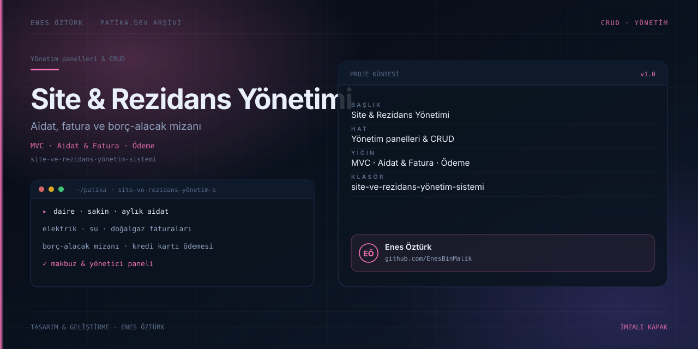

# Site ve Rezidans Yönetim Sistemi



> **Patika.dev arşivi · Yönetim paneli · aidat & fatura** — tasarım ve geliştirme: **Enes Öztürk**

---

Daire, sakin, aylık aidat ve elektrik/su/doğalgaz faturalarını tek panelde toplayan site ve rezidans yönetim sistemi; borç-alacak mizanı ve kredi kartı ödeme akışıyla.

## Öne çıkanlar

- **Yönetici paneli** — daire, sakin ve borç yönetimi.
- **Sakin paneli** — aidat ve fatura görüntüleme, ödeme.
- **Borç-alacak mizanı** — dönem bazlı özet.
- **Kredi kartı ödeme servisi** ve makbuz görünümü.
- Mimari görünüm ve veri modeli notları.

## Teknoloji

React · TypeScript · Vite. Her klasör kendi `package.json`'ına sahip bağımsız bir projedir; kök dizinde kurulum yapılmaz.

## Kurulum ve çalıştırma

```bash
cd "site-ve-rezidans-yönetim-sistemi"
npm install
npm run dev
```

| Komut | Not |
| --- | --- |
| `npm install` | bağımlılıklar |
| `npm run dev` | http://localhost:3000 |
| `npm run build` | üretim derlemesi |
| `npm run lint` | tsc --noEmit |

## Proje yapısı

```
site-ve-rezidans-yönetim-sistemi/
├── index.html
├── package.json
├── docs/cover.svg            # imza kapak
└── src/
    ├── App.tsx               # ekranların birleştiği yer
    ├── main.tsx
    ├── assets/
    ├── components/
    ├── data/
    ├── services/
    └── types/
```

## Lisans

Ödev ve portföy amaçlı çalışma; tüm hakları **Enes Öztürk**'e aittir.
