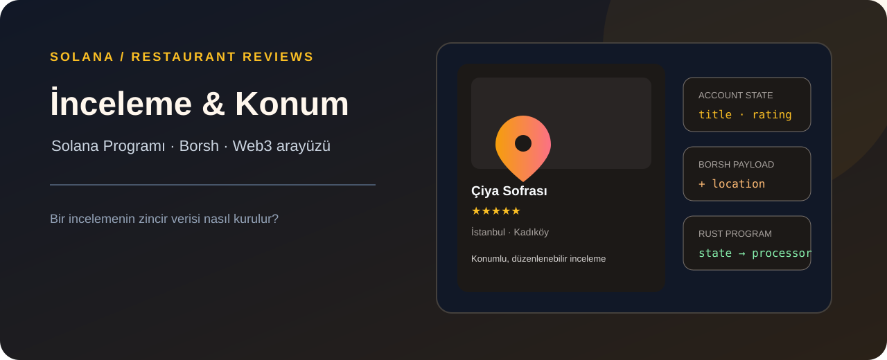

# Solana Restoran İnceleme Programı ve Web3 Arayüzü



> Patika.dev Solana eğitimi için hazırlanmış örnek proje · Enes Öztürk · MIT

Bu depoda hem `program/` altında gerçek bir Solana program crate'i hem de inceleme akışını,
konum filtresini ve Borsh verisini gösteren React arayüzü bulunur.

> **Önemli:** Web arayüzündeki cüzdan bağlantısı, bakiye ve inceleme listesi yerel demo durumudur;
> arayüz şu anda zincire işlem göndermiyor. Aşağıdaki istemci kodu entegrasyon örneğidir. Gerçek
> ağa dağıtım ve işlem gönderimi için ayrıca yapılandırılmış Solana CLI/cüzdan gerekir.

---

## 📌 Proje Genel Bakış ve Amaç (Project Overview & Purpose)

Bu proje, Solana blokzinciri üzerinde çalışan merkeziyetsiz bir **Restoran İnceleme ve Değerlendirme (Restaurant Review)** akıllı sözleşmesi (smart contract) ve modern bir Web3 dApp ön yüzüdür.

Orijinal "Solana Movie Review" temel eğitim müfredatında akıllı sözleşme durumu (account state) yalnızca **başlık (title)**, **puan (rating)** ve **açıklama (description)** tutmaktaydı. Bu nihai mezuniyet projesinde, kullanıcıların restoranları şehir ve semt bazında filtreleyip değerlendirebilmesi için **`location` (konum)** parametresi sözleşmenin ve ön yüzün tüm katmanlarına uçtan uca entegre edilmiştir.

---

## 🚀 Proje Adımları ve Yapılan Değişiklikler (Step-by-Step Implementation)

### 1. Adım: AccountState'e `location` (konum) Alanının Eklenmesi (`state.rs`)
Program durumunu saklayan `AccountState` yapısına restoranın fiziksel konumunu temsil eden `location: String` alanı eklendi:

```rust
#[derive(BorshSerialize, BorshDeserialize, Debug, Clone, PartialEq)]
pub struct AccountState {
    pub is_initialized: bool,
    pub rating: u8,
    pub title: String,
    pub location: String, // 🎯 Adım 1: Yeni eklenen konum (location) değişkeni
    pub description: String,
}
```

Ayrıca hesap kira muafiyeti (rent exemption) ve hesap boyutu tahsisatı için `get_account_size` hesaplayıcısı güncellendi:
```rust
pub fn get_account_size(title: &str, location: &str, description: &str) -> usize {
    1 + 1 + (4 + title.len()) + (4 + location.len()) + (4 + description.len())
}
```

---

### 2. Adım: ReviewInstruction ve ReviewPayload'a `location` Eklenmesi (`instruction.rs`)
İstemciden gönderilen verileri tanımlayan `ReviewPayload` ve program içi yürütme tiplerini belirleyen `ReviewInstruction` enum'una `location: String` eklendi:

```rust
pub enum ReviewInstruction {
    AddReview {
        title: String,
        rating: u8,
        location: String, // 🎯 Adım 2: Konum parametresi talimata eklendi
        description: String,
    },
    UpdateReview {
        title: String,
        rating: u8,
        location: String, // 🎯 Adım 2: Konum parametresi talimata eklendi
        description: String,
    },
}

#[derive(BorshDeserialize, Debug)]
pub struct ReviewPayload {
    pub rating: u8,
    pub title: String,
    pub location: String, // 🎯 Adım 2: Konum parametresi yüke eklendi
    pub description: String,
}
```

---

### 3. Adım: `unpack` Fonksiyonunda `location` Değerinin Açılması (`instruction.rs`)
Ham bayt dizisini çözerek instruction nesnesini oluşturan `unpack` fonksiyonu, `location` alanını payload üzerinden ayrıştıracak şekilde güncellendi:

```rust
pub fn unpack(input: &[u8]) -> Result<Self, ProgramError> {
    let (&variant, rest) = input
        .split_first()
        .ok_or(ProgramError::InvalidInstructionData)?;

    let payload = ReviewPayload::try_from_slice(rest)
        .map_err(|_| ProgramError::InvalidInstructionData)?;

    match variant {
        0 => Ok(Self::AddReview {
            title: payload.title,
            rating: payload.rating,
            location: payload.location, // 🎯 3. Adım: Yeni konum dizisi açıldı
            description: payload.description,
        }),
        1 => Ok(Self::UpdateReview {
            title: payload.title,
            rating: payload.rating,
            location: payload.location, // 🎯 3. Adım: Yeni konum dizisi açıldı
            description: payload.description,
        }),
        _ => Err(ProgramError::InvalidInstructionData),
    }
}
```

---

### 4. Adım: `add_restaurant_review` ve `update_restaurant_review` İçinde `location` Saklanması (`processor.rs`)
Hesap verisi (`account_data`) yazılırken `title`, `rating` ve `description` ile birlikte yeni `location` alanı kaydedildi:

```rust
// 🎯 4. Adım: Ekleme Fonksiyonunda (add_restaurant_review)
let account_state = AccountState {
    is_initialized: true,
    rating,
    title,
    location, // 🎯 Adım 4: Yeni konum alanı account_data içine kaydedildi
    description,
};
account_state.serialize(&mut &mut pda_review.data.borrow_mut()[..])?;

// 🎯 4. Adım: Güncelleme Fonksiyonunda (update_restaurant_review)
account_state.rating = rating;
account_state.location = location; // 🎯 Adım 4: Konum alanı güncellendi
account_state.description = description;
account_state.serialize(&mut &mut pda_review.data.borrow_mut()[..])?;
```

---

### ⭐ Bonus Adım: Ön Yüz Kodunun Konum Desteğiyle Zenginleştirilmesi
- İnceleme ekleme ve düzenleme pencerelerinde (modals) interaktif konum seçici (İstanbul Kadıköy, İzmir Alsancak, Ankara Çankaya, vb.).
- Konuma göre dinamik arama, filtreleme ve sıralama çubuğu.
- Canlı Borsh serileştirici (Hex bayt analizörü) ile bayt yapısının gerçek zamanlı incelenmesi.
- Solana PDA (Program Derived Address) türetim hesaplayıcısı.
- Akıllı sözleşme Rust kaynak kodlarını doğrudan tarayıcıdan inceleme ve kopyalama modülü.

---

## 🛠️ Sözleşmenin Derlenmesi ve Dağıtımı (Build & Deploy Guide)

### Gereksinimler
- Rust & Cargo (`rustc --version >= 1.70.0`)
- Solana CLI (`solana --version >= 1.18.0`)
- Node.js & npm / yarn

### 1. Akıllı Sözleşmeyi Derleme (Rust BPF / SBF)
```bash
cd program
cargo build-sbf
# veya eski sürümler için:
# cargo build-bpf
```
Derleme sonucunda `target/deploy/solana_restaurant_review.so` ikili dosyası üretilir.

### 2. Solana CLI Ağını Ayarlama (Devnet Örneği)
```bash
solana config set --url https://api.devnet.solana.com
solana airdrop 2
```

### 3. Programı Solana Devnet'e Dağıtma (Deploy)
```bash
solana program deploy target/deploy/solana_restaurant_review.so
```
Komut başarıyla tamamlandığında konsola `<PROGRAM_ID>` adresi yazdırılacaktır.

---

## 💻 İstemci (Client) Entegrasyonu: `@solana/web3.js` & Borsh

### 1. PDA (Program Derived Address) Hesaplama
```typescript
import { PublicKey } from '@solana/web3.js';

export function getRestaurantReviewPDA(
  userPublicKey: PublicKey,
  restaurantTitle: string,
  programId: PublicKey
): [PublicKey, number] {
  return PublicKey.findProgramAddressSync(
    [
      userPublicKey.toBuffer(),
      Buffer.from(restaurantTitle, 'utf-8')
    ],
    programId
  );
}
```

### 2. Borsh Talimat Yükünü Serileştirme
```typescript
import * as borsh from 'borsh';

class RestaurantReviewInstruction {
  variant: number;
  rating: number;
  title: string;
  location: string; // 🎯 Konum alanı
  description: string;

  constructor(fields: { variant: number; rating: number; title: string; location: string; description: string }) {
    this.variant = fields.variant;
    this.rating = fields.rating;
    this.title = fields.title;
    this.location = fields.location;
    this.description = fields.description;
  }
}

const instructionSchema = new Map([
  [
    RestaurantReviewInstruction,
    {
      kind: 'struct',
      fields: [
        ['variant', 'u8'],
        ['rating', 'u8'],
        ['title', 'string'],
        ['location', 'string'],
        ['description', 'string'],
      ],
    },
  ],
]);

// Yeni inceleme ekleme verisini paketle:
const payload = new RestaurantReviewInstruction({
  variant: 0, // 0 = AddReview
  rating: 5,
  title: 'Çiya Sofrası',
  location: 'İstanbul, Kadıköy',
  description: 'Geleneksel Anadolu lezzetleri ve otlu mezeler harika.',
});

const serializedData = borsh.serialize(instructionSchema, payload);
```

### 3. Solana İşlemi Gönderme
```typescript
import { Transaction, TransactionInstruction, SystemProgram } from '@solana/web3.js';

const instruction = new TransactionInstruction({
  keys: [
    { pubkey: userWallet.publicKey, isSigner: true, isWritable: true },
    { pubkey: pdaReviewAddress, isSigner: false, isWritable: true },
    { pubkey: SystemProgram.programId, isSigner: false, isWritable: false },
  ],
  programId: PROGRAM_ID,
  data: Buffer.from(serializedData),
});

const transaction = new Transaction().add(instruction);
const signature = await sendAndConfirmTransaction(connection, transaction, [userWallet]);
console.log('İşlem İmzası:', signature);
```

---

## 🔒 Güvenlik & Kontroller (Security Invariants)

1. **İmza Doğrulaması:** İncelemeyi ekleyen/güncelleyen kullanıcının `initializer.is_signer` olduğu mutlaka denetlenir.
2. **Puan Doğrulaması:** Puanın `1 <= rating <= 5` aralığında olduğu kontrol edilir, aksi halde `ReviewError::InvalidRating` döner.
3. **PDA Doğrulaması:** `[initializer_pubkey, title]` seed'leri ile türetilen PDA adresi gelen hesapla birebir eşleşmelidir; sahte hesap enjeksiyonu önlenir.
4. **Metin Sınırları:** Başlık ($\le 50$), Konum ($\le 100$), Açıklama ($\le 500$) bayt ile sınırlandırılarak blok boyutu ve kira maliyeti optimize edilmiştir.
5. **Dinamik Yeniden Boyutlandırma (Realloc):** Güncelleme işleminde yeni açıklama veya konum eski hesaptan daha büyükse `realloc` ve fark kira lamport transferi otomatik gerçekleştirilir.

---

## 🎓 Açık Kaynak Mezuniyet Notu

Bu proje, Solana Web3 ekosisteminin açık kaynak ve şeffaf kodlama kültürünü desteklemek amacıyla hazırlanmıştır. Tüm sözleşme ve dApp kodları herkese açık olarak incelenebilir.

Hazırlayan ve Geliştiren: **Enes Öztürk 🔥**  
İletişim & Profil: [enesbino38@gmail.com](mailto:enesbino38@gmail.com)  
*Solana Ekosistemine Sevgilerle!* 🚀
