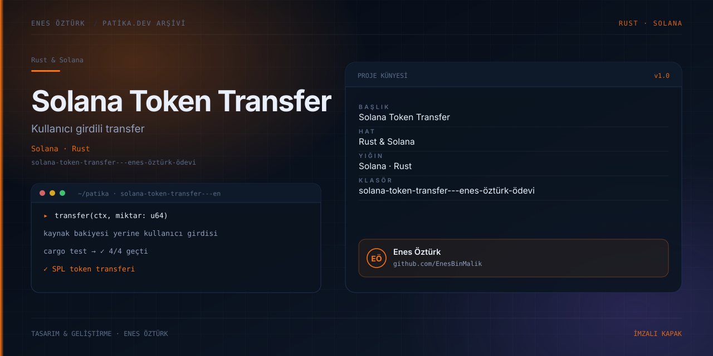

# Solana Token Transfer - Enes Öztürk Ödevi



> **Patika.dev arşivi · Solana · token transferi** — tasarım ve geliştirme: **Enes Öztürk**

---

Kaynak hesap bakiyesi yerine kullanıcı girdisiyle transfer yapan Solana/Rust token transferi ödevi.

## Öne çıkanlar

- Miktar parametreli transfer talimatı.
- Bakiye ve yetki kontrolleri.
- `cargo test` senaryolarının gösterimi.
- İşlem akışının simülasyonu.

## Teknoloji

React · TypeScript · Vite. Her klasör kendi `package.json`'ına sahip bağımsız bir projedir; kök dizinde kurulum yapılmaz.

## Kurulum ve çalıştırma

```bash
cd "solana-token-transfer---enes-öztürk-ödevi"
npm install
npm run dev
```

| Komut | Not |
| --- | --- |
| `npm install` | bağımlılıklar |
| `npm run dev` | http://localhost:3000 |
| `npm run build` | üretim derlemesi |

## Proje yapısı

```
solana-token-transfer---enes-öztürk-ödevi/
├── index.html
├── package.json
├── docs/cover.svg            # imza kapak
└── src/
    ├── App.tsx               # ekranların birleştiği yer
    ├── main.tsx
    ├── components/
    └── data/
```

## Lisans

Ödev ve portföy amaçlı çalışma; tüm hakları **Enes Öztürk**'e aittir.
