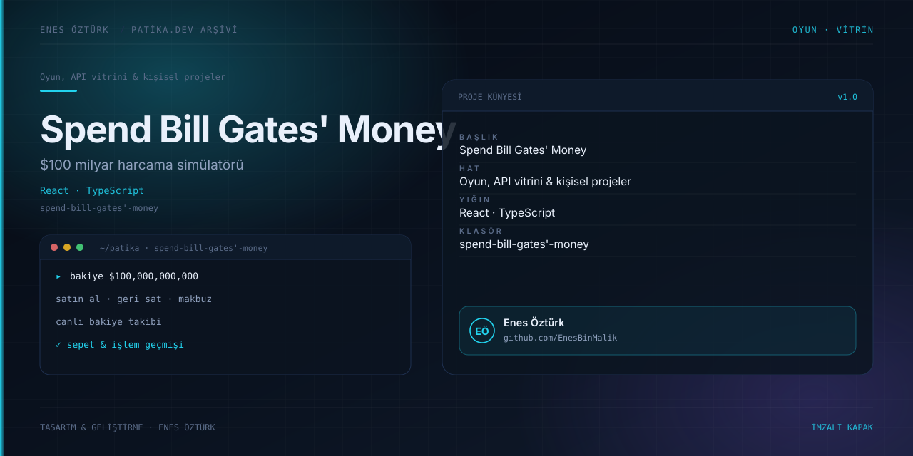

# Spend Bill Gates' Money



> **Patika.dev arşivi · React · eğlence uygulaması** — tasarım ve geliştirme: **Enes Öztürk**

---

100 milyar dolarlık bütçeyle lüks ve absürt ürünler satın alma simülatörü.

## Öne çıkanlar

- Canlı bakiye takibi.
- Satın al / geri sat düğmeleri.
- Sepet ve makbuz görünümü.
- Sıfırlama ve baştan başlama.

## Teknoloji

React · TypeScript · Vite. Her klasör kendi `package.json`'ına sahip bağımsız bir projedir; kök dizinde kurulum yapılmaz.

## Kurulum ve çalıştırma

```bash
cd "spend-bill-gates'-money"
npm install
npm run dev
```

| Komut | Not |
| --- | --- |
| `npm install` | bağımlılıklar |
| `npm run dev` | http://localhost:3000 |
| `npm run build` | üretim derlemesi |

## Proje yapısı

```
spend-bill-gates'-money/
├── index.html
├── package.json
├── docs/cover.svg            # imza kapak
└── src/
    ├── App.tsx               # ekranların birleştiği yer
    ├── main.tsx
    ├── assets/
    ├── components/
    ├── data/
    └── utils/
```

## Lisans

Ödev ve portföy amaçlı çalışma; tüm hakları **Enes Öztürk**'e aittir.
