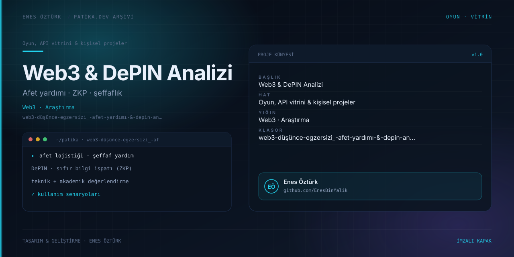

# Web3 Düşünce Egzersizi: Afet Yardımı & DePIN Analizi - Enes Öztürk



> **Patika.dev arşivi · Web3 · araştırma** — tasarım ve geliştirme: **Enes Öztürk**

---

Afet lojistiği ve şeffaf insani yardımda Web3, DePIN ve sıfır bilgi ispatlarının (ZKP) kullanımına dair teknik ve akademik analiz.

## Öne çıkanlar

- Afet yardımı senaryoları ve aktör haritası.
- DePIN altyapısı ve donanım gereksinimleri.
- ZKP ile mahremiyet ve şeffaflık dengesi.
- Riskler, maliyetler ve sonuç değerlendirmesi.

## Teknoloji

React · TypeScript · Vite. Her klasör kendi `package.json`'ına sahip bağımsız bir projedir; kök dizinde kurulum yapılmaz.

## Kurulum ve çalıştırma

```bash
cd "web3-düşünce-egzersizi_-afet-yardımı-&-depin-analizi---enes-öztürk"
npm install
npm run dev
```

| Komut | Not |
| --- | --- |
| `npm install` | bağımlılıklar |
| `npm run dev` | http://localhost:3000 |
| `npm run build` | üretim derlemesi |

## Proje yapısı

```
web3-düşünce-egzersizi_-afet-yardımı-&-depin-analizi---enes-öztürk/
├── index.html
├── package.json
├── docs/cover.svg            # imza kapak
└── src/
    ├── App.tsx               # ekranların birleştiği yer
    ├── main.tsx
    ├── assets/
    ├── components/
    ├── data/
    └── types/
```

## Lisans

Ödev ve portföy amaçlı çalışma; tüm hakları **Enes Öztürk**'e aittir.
