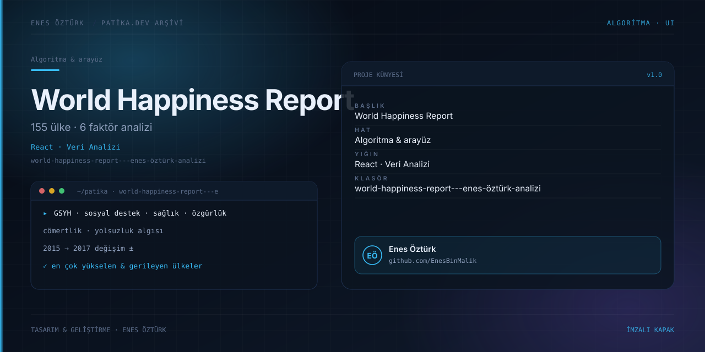

# World Happiness Report - Enes Öztürk Analizi



> **Patika.dev arşivi · Veri analizi** — tasarım ve geliştirme: **Enes Öztürk**

---

155 ülkenin altı temel faktör üzerinden mutluluk skorlarını, 2015–2017 değişimini ve en çok yükselen–gerileyen ülkeleri inceleyen analiz platformu.

## Öne çıkanlar

- GSYH, sosyal destek, sağlıklı yaşam, özgürlük, cömertlik ve yolsuzluk algısı kırılımı.
- Ülke karşılaştırma aracı ve mutluluk simülatörü.
- 2015–2017 değişim görünümü.
- Vaka incelemeleri ve analist notu.

## Teknoloji

React · TypeScript · Vite. Her klasör kendi `package.json`'ına sahip bağımsız bir projedir; kök dizinde kurulum yapılmaz.

## Kurulum ve çalıştırma

```bash
cd "world-happiness-report---enes-öztürk-analizi"
npm install
npm run dev
```

| Komut | Not |
| --- | --- |
| `npm install` | bağımlılıklar |
| `npm run dev` | http://localhost:3000 |
| `npm run build` | üretim derlemesi |

## Proje yapısı

```
world-happiness-report---enes-öztürk-analizi/
├── index.html
├── package.json
├── docs/cover.svg            # imza kapak
└── src/
    ├── App.tsx               # ekranların birleştiği yer
    ├── main.tsx
    ├── assets/
    ├── components/
    └── data/
```

## Lisans

Ödev ve portföy amaçlı çalışma; tüm hakları **Enes Öztürk**'e aittir.
