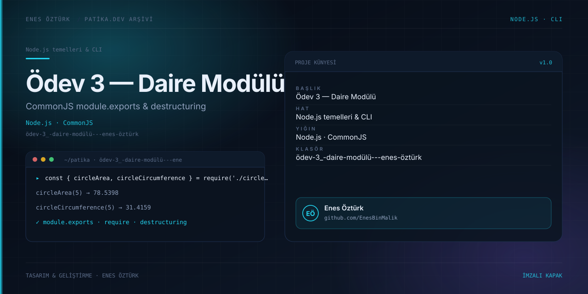

# Ödev 3: Daire Modülü - Enes Öztürk



> **Patika.dev arşivi · Node.js · modül sistemi** — tasarım ve geliştirme: **Enes Öztürk**

---

`circleArea` ve `circleCircumference` fonksiyonlarını CommonJS ile dışa aktaran daire modülü ödevi.

## Öne çıkanlar

- `module.exports` ile dışa aktarma.
- `require` ve nesne ayrıştırma (destructuring).
- Alan ve çevre hesabı örnekleri.
- Modül yapısının anlatımı.

## Teknoloji

React · TypeScript · Vite. Her klasör kendi `package.json`'ına sahip bağımsız bir projedir; kök dizinde kurulum yapılmaz.

## Kurulum ve çalıştırma

```bash
cd "ödev-3_-daire-modülü---enes-öztürk"
npm install
npm run dev
```

| Komut | Not |
| --- | --- |
| `npm install` | bağımlılıklar |
| `npm run dev` | http://localhost:3000 |
| `npm run build` | üretim derlemesi |

## Proje yapısı

```
ödev-3_-daire-modülü---enes-öztürk/
├── index.html
├── package.json
├── docs/cover.svg            # imza kapak
└── src/
    ├── App.tsx               # ekranların birleştiği yer
    ├── main.tsx
    ├── components/
    └── data/
```

## Lisans

Ödev ve portföy amaçlı çalışma; tüm hakları **Enes Öztürk**'e aittir.
