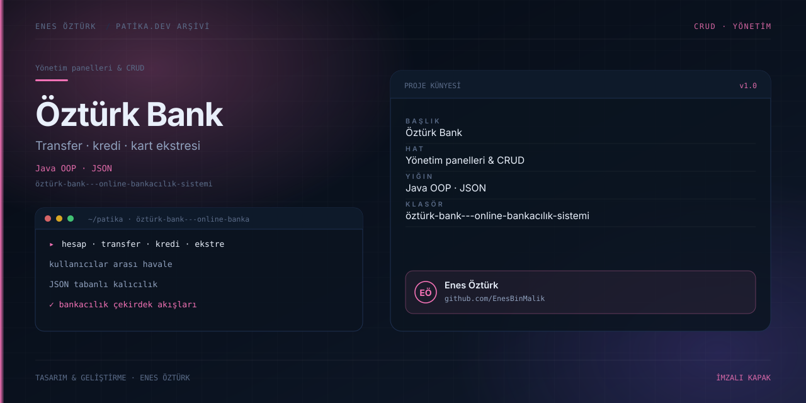

# Öztürk Bank - Online Bankacılık Sistemi



> **Patika.dev arşivi · Java OOP · bankacılık** — tasarım ve geliştirme: **Enes Öztürk**

---

Java OOP mimarisiyle yazılmış, JSON tabanlı kalıcılık kullanan online bankacılık sistemi: hesaplar arası transfer, kredi ve kart ekstresi ödemesi.

## Öne çıkanlar

- Müşteri, hesap ve hareket yönetimi.
- Kullanıcılar arası para transferi.
- Kredi başvurusu ve kart ekstresi ödemesi.
- JSON dosyası üzerinden kalıcı veri.

## Teknoloji

React · TypeScript · Vite. Her klasör kendi `package.json`'ına sahip bağımsız bir projedir; kök dizinde kurulum yapılmaz.

## Kurulum ve çalıştırma

```bash
cd "öztürk-bank---online-bankacılık-sistemi"
npm install
npm run dev
```

| Komut | Not |
| --- | --- |
| `npm install` | bağımlılıklar |
| `npm run dev` | http://localhost:3000 |
| `npm run build` | üretim derlemesi |

## Proje yapısı

```
öztürk-bank---online-bankacılık-sistemi/
├── index.html
├── package.json
├── docs/cover.svg            # imza kapak
└── src/
    ├── App.tsx               # ekranların birleştiği yer
    ├── main.tsx
    ├── components/
    ├── data/
    ├── models/
    ├── services/
    └── types/
```

## Lisans

Ödev ve portföy amaçlı çalışma; tüm hakları **Enes Öztürk**'e aittir.
