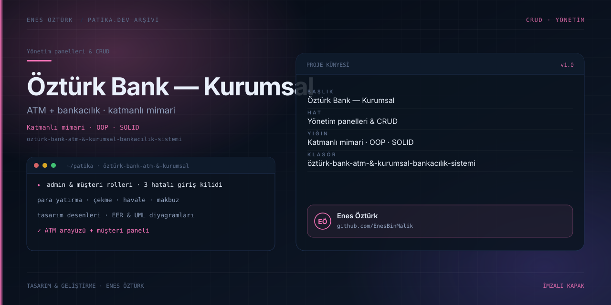

# Öztürk Bank ATM & Kurumsal Bankacılık Sistemi



> **Patika.dev arşivi · Kurumsal mimari · bankacılık** — tasarım ve geliştirme: **Enes Öztürk**

---

ATM arayüzü ile müşteri ve yönetici panellerini tek sistemde birleştiren kurumsal bankacılık uygulaması; katmanlı mimari, OOP ve tasarım desenleri üzerine kurulu.

## Öne çıkanlar

- **ATM arayüzü** — giriş, para yatırma/çekme, havale ve makbuz.
- **Admin & müşteri rolleri** — yetkiye göre açılan paneller.
- **3 hatalı giriş koruması** — hesap kilitleme ve uyarı.
- **Tasarım desenleri** ve `src/core` katman ayrımı.
- **EER / UML diyagramları** ve Spring Boot mimari görünümü.

## Teknoloji

React · TypeScript · Vite · katmanlı mimari. Her klasör kendi `package.json`'ına sahip bağımsız bir projedir; kök dizinde kurulum yapılmaz.

## Kurulum ve çalıştırma

```bash
cd "öztürk-bank-atm-&-kurumsal-bankacılık-sistemi"
npm install
npm run dev
```

| Komut | Not |
| --- | --- |
| `npm install` | bağımlılıklar |
| `npm run dev` | http://localhost:3000 |
| `npm run build` | üretim derlemesi |
| `npm run lint` | tsc --noEmit |

## Proje yapısı

```
öztürk-bank-atm-&-kurumsal-bankacılık-sistemi/
├── index.html
├── package.json
├── docs/cover.svg            # imza kapak
└── src/
    ├── App.tsx               # ekranların birleştiği yer
    ├── main.tsx
    ├── components/
    └── core/
```

## Lisans

Ödev ve portföy amaçlı çalışma; tüm hakları **Enes Öztürk**'e aittir.
