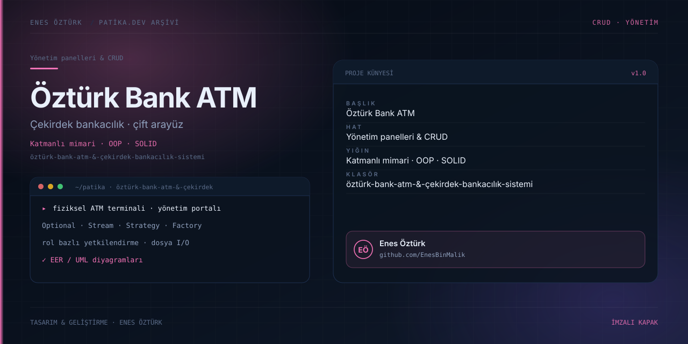

# Öztürk Bank ATM & Çekirdek Bankacılık Sistemi



> **Patika.dev arşivi · Kurumsal mimari · bankacılık** — tasarım ve geliştirme: **Enes Öztürk**

---

Çekirdek bankacılık mantığını iki arayüzde sunan sistem: fiziksel ATM terminali ve yönetim portalı; OOP, S.O.L.I.D ve katmanlı mimari üzerine kurulu.

## Öne çıkanlar

- **ATM terminali** — kart girişi, bakiye, para yatırma/çekme ve transfer.
- **Yönetim portalı** — müşteri, hesap ve işlem yönetimi.
- **Çevrimiçi bankacılık** — rol bazlı yetkilendirme.
- **Çekirdek katman** — `Optional`, `Stream`, Strategy, Factory ve özel istisnalar.
- **EER / UML diyagramları** ve dosya I/O kalıcılığı.

## Teknoloji

React · TypeScript · Vite · katmanlı mimari. Her klasör kendi `package.json`'ına sahip bağımsız bir projedir; kök dizinde kurulum yapılmaz.

## Kurulum ve çalıştırma

```bash
cd "öztürk-bank-atm-&-çekirdek-bankacılık-sistemi"
npm install
npm run dev
```

| Komut | Not |
| --- | --- |
| `npm install` | bağımlılıklar |
| `npm run dev` | http://localhost:3000 |
| `npm run build` | üretim derlemesi |
| `npm run lint` | tsc --noEmit |

## Proje yapısı

```
öztürk-bank-atm-&-çekirdek-bankacılık-sistemi/
├── index.html
├── package.json
├── docs/cover.svg            # imza kapak
└── src/
    ├── App.tsx               # ekranların birleştiği yer
    ├── main.tsx
    ├── components/
    ├── core/
    ├── types/
    └── utils/
```

## Lisans

Ödev ve portföy amaçlı çalışma; tüm hakları **Enes Öztürk**'e aittir.
